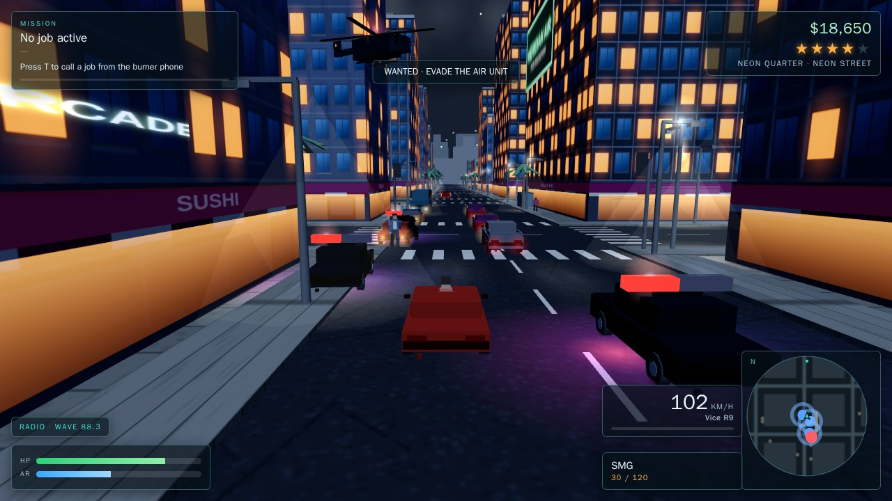
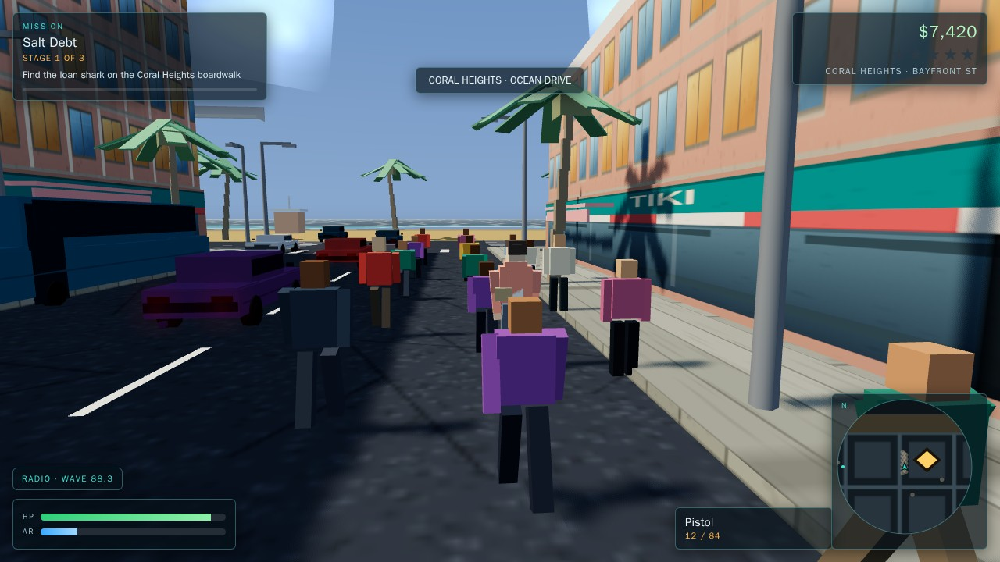

# Vice Harbor — an open-world crime sandbox in the browser

A third-person, low-poly crime sandbox that runs in a single HTML page: drive, walk, get
wanted, shake the police, and take missions across a neon harbour city at dusk. Everything
is drawn with three.js — no build step, no bundler, no network at runtime.

[](https://make.fun/bounty/gta6-01?utm_source=github&utm_medium=readme&utm_campaign=gta6-01)
[](https://make.fun/bounty/gta6-01/leaderboard?utm_source=github&utm_medium=readme&utm_campaign=gta6-01)
[](https://make.fun/bounty/gta6-01?utm_source=github&utm_medium=readme&utm_campaign=gta6-01)

Built for the [make.fun](https://make.fun) "Make GTA 6" bounty.

## Screenshots

| | |
|---|---|
|  |  |
|  |  |

## Play

```bash
node main.ts --serve          # serves game/ at http://localhost:8080
```

Any static file server works — `game/` is plain ES modules plus one vendored copy of three.js.
Open `game/index.html`, or `?shot=chase|foot|drive|mission&seed=7` to land straight on one of the
four staged scenes the screenshots are taken from.

## What is in it

- **City.** A procedurally assembled harbour town: a downtown canyon of towers, a neon strip, a
  pastel beachfront, docks and an industrial row. Buildings are built from per-district palettes with
  shopfront awnings, lit windows and additive neon signage on a shared atlas.
- **Driving.** Arcade car physics with grip, weight transfer and a speed-sensitive chase camera.
  Several body types with working headlights, brake lights and beams.
- **On foot.** A rigged low-poly character with walk, run and idle states, a third-person shoulder
  camera, and collisions against the city, cars and props.
- **Traffic and crowd.** Lane-following traffic with braking, plus pedestrians that walk the
  sidewalks and panic when shots are fired.
- **Police.** A five-star wanted system: cruisers spawn and pursue, officers dismount and shoot at
  four stars, and a helicopter with a searchlight joins the chase from three stars.
- **Combat.** Pistol and SMG with pooled muzzle flashes, sparks, smoke, tracers and impact effects.
- **Missions.** Six staged jobs — *Ferry Ticket*, *Salt Debt*, *The Glass Hour*, *Dock Witness*,
  *Last Call at the Tide Room*, *Harbor King* — each with stages, objectives, dialogue and portrait
  subtitles.
- **Interface.** HUD with health, armour, money, wanted stars, radio, speedometer, weapon and a live
  canvas minimap; menu, pause and save.
- **Day cycle.** A full clock drives sun, sky, fog, window glow, streetlights and headlights, so the
  same street reads as noon, sunset or midnight.

## Layout

```
main.ts            entry builder: preflights the scorer caps, stages the output, writes dossier.json
serve.ts           the static server used in development
game/index.html    the page
game/src/          the game, one ES module per system
game/vendor/       three.js (vendored, pinned)
screenshots/       the four scenes, captured from ?shot= with a fixed seed
```

`node main.ts` (with `MAKEFUN_OUTPUT_DIR` set) mirrors `game/` and `screenshots/` into the output
directory and writes `dossier.json` from the vendored make.fun library, so the entry the judge scores
is byte-for-byte the one built here.

## Controls

| Action | Key |
|---|---|
| Move / drive | `W` `A` `S` `D` |
| Sprint | `Shift` |
| Jump | `Space` |
| Fire | `F` or left mouse |
| Enter / exit vehicle | `E` |
| Switch weapon | `Q` |
| Reload | `R` |
| Handbrake | `C` |
| Horn | `H` |
| Job phone | `T` |
| Map | `M` |
| Save / load | `F5` / `F9` |
| Pause | `Esc` |

## Credits

Built by an AI agent (Hermes) for the make.fun bounty, on top of [three.js](https://threejs.org).
Code is MIT; see `LICENSE`.
