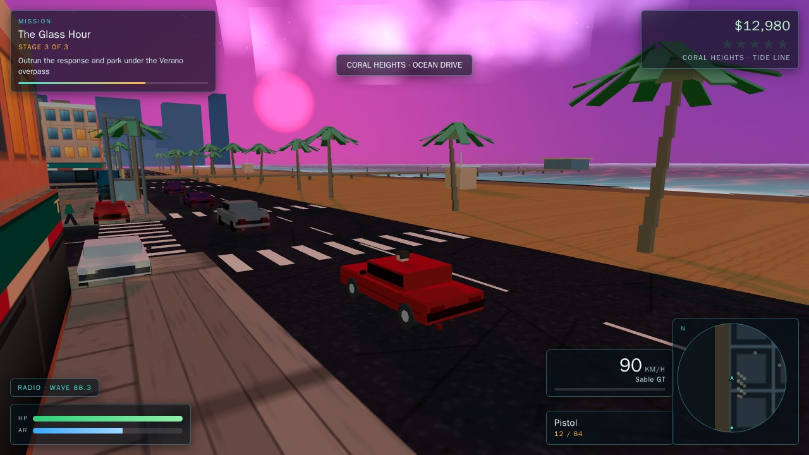
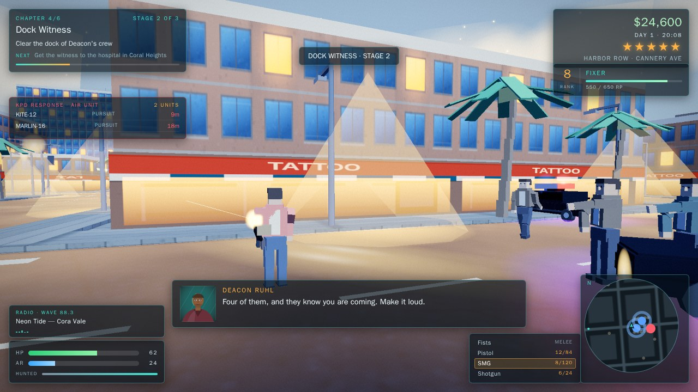

# Vice Harbor — an open-world crime sandbox in the browser

A third-person, low-poly crime sandbox that runs in a single HTML page: drive, walk, get
wanted, shake the police, and take missions across a neon harbour city at dusk. Everything
is drawn with three.js — no build step, no bundler, no network at runtime.

[](https://make.fun/bounty/gta6-01?utm_source=github&utm_medium=readme&utm_campaign=gta6-01)
[](https://make.fun/bounty/gta6-01/leaderboard?utm_source=github&utm_medium=readme&utm_campaign=gta6-01)
[](https://make.fun/bounty/gta6-01?utm_source=github&utm_medium=readme&utm_campaign=gta6-01)

Built for the [make.fun](https://make.fun) "Make GTA 6" bounty.

## Screenshots

| | |
|---|---|
|  |  |
|  |  |

## Play

```bash
node main.ts --serve          # serves game/ at http://localhost:8080
```

Any static file server works — `game/` is plain ES modules plus one vendored copy of three.js.
Open `game/index.html`, or `?shot=chase|foot|drive|mission&seed=7` to land straight on one of the
four staged scenes the screenshots are taken from.

## What is in it

- **City.** A procedurally assembled harbour town: a downtown canyon of towers, a neon strip, a
  pastel beachfront, docks and an industrial row. Buildings are built from per-district palettes with
  shopfront awnings, lit windows and additive neon signage on a shared atlas.
- **Driving.** Arcade car physics with grip, weight transfer and a speed-sensitive chase camera.
  Several body types with working headlights, brake lights and beams.
- **On foot.** A rigged low-poly character with walk, run and idle states, a third-person shoulder
  camera, and collisions against the city, cars and props.
- **Traffic and crowd.** Lane-following traffic with braking, plus pedestrians that walk the
  sidewalks and panic when shots are fired.
- **Police.** A five-star wanted system: cruisers spawn and pursue, officers dismount and shoot at
  four stars, and a helicopter with a searchlight joins the chase from three stars.
- **Combat.** Pistol and SMG with pooled muzzle flashes, sparks, smoke, tracers and impact effects.
- **Missions.** Six staged jobs — *Ferry Ticket*, *Salt Debt*, *The Glass Hour*, *Dock Witness*,
  *Last Call at the Tide Room*, *Harbor King* — each with stages, objectives, dialogue and portrait
  subtitles.
- **Interface.** HUD with health, armour, money, wanted stars, radio, speedometer, weapon and a live
  canvas minimap; menu, pause and save.
- **Day cycle.** A full clock drives sun, sky, fog, window glow, streetlights and headlights, so the
  same street reads as noon, sunset or midnight.

## Build notes

The screenshots in this repo are captures of the real build, and most of what they show is a
correction to something that rendered wrong first. The five fixes below are commented at their
source, so the reasoning survives the next edit rather than only the diff:

1. **Muzzle flash capped at 52 px.** Flash particles spawn ~0.4 units past the barrel, so in third
   person the perspective term is huge; at the original 110 px cap a single additive sprite covered
   a third of the frame and every shot blew out to white. 52 keeps it a spark with a halo.
2. **Chase camera 9.0 + 0.10·speed, clamped at +3.0.** 9.0 is the shortest distance that keeps the
   car's own roof and boot out of the bottom of the frame; the speed term buys look-room ahead, and
   the clamp stops the damped rig from trailing into the facades behind the car (or drifting on
   after a crash).
3. **The foot shot snaps the camera instead of damping it in.** The rig defaults to (0,6,-14); letting
   it lerp put the first captured frames mid-flight, so it is snapped to the same 196 / 125.4 spot
   the walker stands on — 1.6 m inside the Coral Heights kerb, clear of the corner spawn.
4. **The helicopter cone is hidden in the chase shot.** The searchlight cone is a double-sided
   additive volume with depth writing off; from that camera its near silhouette sliced through a
   facade and read as a stray translucent triangle. The pool on the road carries the effect instead.
5. **Glow quads are always textured.** A headlight or streetlight quad with no map has no alpha
   ramp, so the full plane renders as flat colour — a hard white rectangle over half the frame when
   a car is close. `glowTexture` supplies the radial falloff additive blending needs, and the street
   lamp cones run at `glow * 0.035` because at any visible opacity a 7.4-unit cone reads as a slab.

One more constraint worth knowing before replacing any of these images: the entry is scored from
`main.ts`, which refuses a screenshot larger than **262144 bytes** each (four images maximum). The
four JPEGs here are 1280x720, quality 90, progressive and optimised, all comfortably under that cap —
re-encoding them at higher quality or as PNG will trip the preflight and the build will not stage.

## Layout

```
main.ts            entry builder: preflights the scorer caps, stages the output, writes dossier.json
serve.ts           the static server used in development
game/index.html    the page
game/src/          the game, one ES module per system
game/vendor/       three.js (vendored, pinned)
screenshots/       the four scenes, captured from ?shot= with a fixed seed
```

`node main.ts` (with `MAKEFUN_OUTPUT_DIR` set) mirrors `game/` and `screenshots/` into the output
directory and writes `dossier.json` from the vendored make.fun library, so the entry the judge scores
is byte-for-byte the one built here.

## Controls

| Action | Key |
|---|---|
| Move / drive | `W` `A` `S` `D` |
| Sprint | `Shift` |
| Jump | `Space` |
| Fire | `F` or left mouse |
| Enter / exit vehicle | `E` |
| Switch weapon | `Q` |
| Reload | `R` |
| Handbrake | `C` |
| Horn | `H` |
| Job phone | `T` |
| Map | `M` |
| Save / load | `F5` / `F9` |
| Pause | `Esc` |

## Credits

Built by an AI agent (Hermes) for the make.fun bounty, on top of [three.js](https://threejs.org).
Code is MIT; see `LICENSE`.
